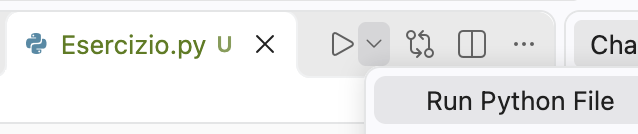
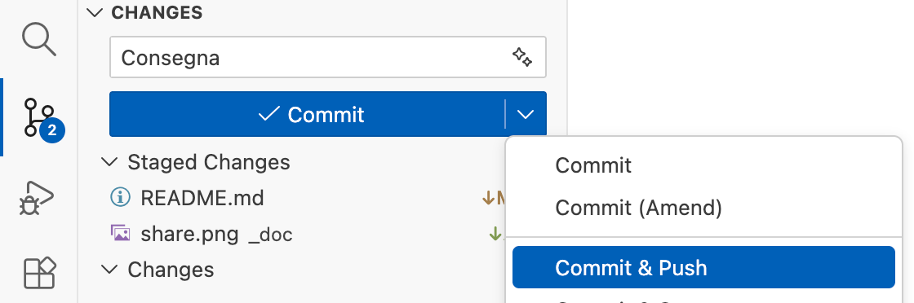
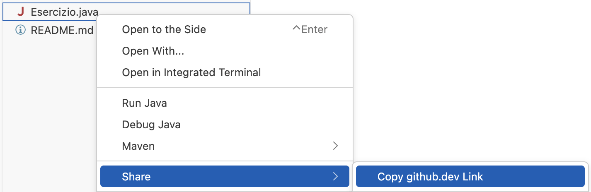

# Istruzioni
**Scrivere il programma**
- Creare dei file python vuoti (es. Esercizio.py) e modificarne il contenuto

**Eseguire il programma**
- Aprire il file python (es. Esercizio.py)
- Selezionare l'icona "run" e poi "run Python File" 
 
- aprire TERMINAL per controllare il risultato

**Consegnare su classroom**
- [Source Control] sulla sinistra
- **scrivere il messaggio** "Consegna" **nella casella di testo Message**
- [Commit & Push] dal pulsante dropdown
  
- **Copiare il link di Esercizio.py e consegnarlo su classroom**
  

**Prof, ho un problema...**
- Non riesco ad eseguire il programma, ottengo un errore del tipo "non trovo il file launch.json"
   - Riaprire il compito dal link ricevuto (ad es. da Google Classroom)
   - Attendere che l'ambiente abbia terminato il caricamento completo
   - Eseguire il programma
- La consegna risulta "appesa", senza procedere:
   - non è stato inserito alcun testo nella la casella Message.
   - Chiudere la finestra "COMMIT_EDITMSG", scrivere "Consegna" nella casella Message, premere il pulsante [Commit & Push]
- Per la consegna compare il pulsante [Synch Changes] al posto di [Commit]
   - digitare su TERMINAL il comando: git config pull.rebase false
   - Premere il pulsante [Synch Changes]
